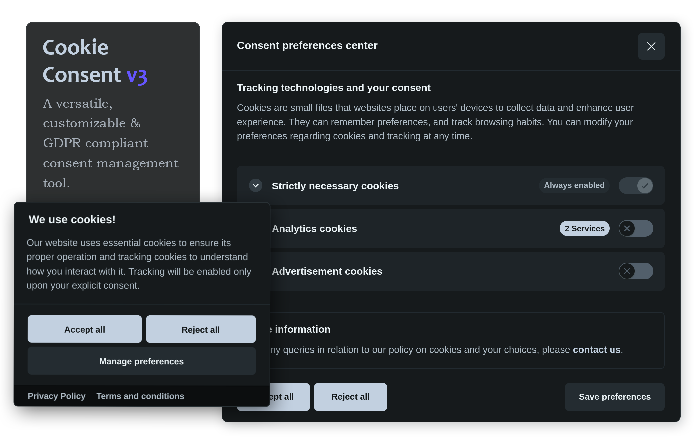

# Kirby Cookieconsent plugin



A plugin to implement [cookieconsent](https://github.com/orestbida/cookieconsent) in Kirby.

- Uses the open source cookieconsent library
- Provides default translations for 5 cookie categories
- Multilingual support (EN/DE/FR)
- Customizable

## Table of Contents

- [Kirby Cookieconsent plugin](#kirby-cookieconsent-plugin)
  - [Table of Contents](#table-of-contents)
  - [1. Installation](#1-installation)
    - [1.1 Composer](#11-composer)
    - [1.2 Download](#12-download)
    - [1.3 Git submodule](#13-git-submodule)
  - [2. Setup](#2-setup)
    - [2.1 How the assets are loaded](#21-how-the-assets-are-loaded)
    - [2.2 Troubleshooting: 403 on /media/plugins/zephir/cookieconsent/...](#22-troubleshooting-403-on-mediapluginszephircookieconsent)
  - [3. Options](#3-options)
    - [3.1 Available options](#31-available-options)
    - [3.2 Defaults](#32-defaults)
    - [3.3 Predefined cookie categories](#33-predefined-cookie-categories)
    - [3.4 Removing a category](#34-removing-a-category)
  - [4. Language](#4-language)
  - [5. Translations](#5-translations)
    - [5.1 Overriding specific translations](#51-overriding-specific-translations)
  - [6. Events](#6-events)
  - [License](#license)
  - [Credits](#credits)


## 1. Installation

The recommended way of installing is by using Composer.

### 1.1 Composer

```
composer require zephir/kirby-cookieconsent
```

### 1.2 Download

Download and copy this repository to `/site/plugins/kirby-cookieconsent`.

### 1.3 Git submodule

```
git submodule add https://github.com/zephir/kirby-cookieconsent.git site/plugins/kirby-cookieconsent
```

## 2. Setup

Add `snippet('cookieconsentCss')` to your header and `snippet('cookieconsentJs')` to your footer.

### 2.1 How the assets are loaded

The snippets output three tags:

```html
<link rel="stylesheet" href="https://example.com/media/plugins/zephir/cookieconsent/4205341454-1732460000/index.css">
<script defer src="https://example.com/media/plugins/zephir/cookieconsent/2046731778-1732460000/index.js"></script>
<script defer src="https://example.com/cookieconsent.js?v=99b40bdf"></script>
```

- `index.css` and `index.js` are the compiled cookieconsent library. They are Kirby plugin assets, so their URLs come from Kirby (`$kirby->plugin('zephir/cookieconsent')->asset('index.js')->url()`) and contain a hash that changes when the files change. Kirby links them into `media/plugins` on the first request, so an empty or deleted `media` folder is fine.
- `/cookieconsent.js` is the configuration built from your options. The `v` parameter changes whenever your options change, so visitors get the new configuration right away (for example after you raise `revision`). On multi-language sites the URL starts with the language prefix (`/de/cookieconsent.js`).
- The tags are written directly, not through Kirby's `css()`/`js()` helpers. That way cache-buster plugins such as [schnti/cachebuster](https://github.com/schnti/kirby3-cachebuster) leave these URLs alone; they are already versioned.
- With `'cdn' => true`, the library comes from jsDelivr (cookieconsent v3.3.0, pinned with Subresource Integrity hashes) and `/media/plugins` is not used. The configuration script is always served by your site.

If you use Kirby's pages cache, clear it after updating the plugin, as after any deploy. Cached pages otherwise still point to the hash of the old files.

### 2.2 Troubleshooting: 403 on `/media/plugins/zephir/cookieconsent/...`

Kirby publishes plugin assets by creating a symlink in `media/plugins/` that points to the file in `site/plugins/kirby-cookieconsent/assets/`. The first request is answered by Kirby itself; later requests are served by the web server through that symlink. On some shared hosts (reported on Mittwald), PHP sees the site under a different path than the web server (for example `/html/...` instead of `/home/www/p123456/html/...`). The symlink then points to a path the web server cannot resolve, and Apache answers `403 Forbidden` ("Symbolic link not allowed or link target not accessible"). This happens to every Kirby plugin's frontend assets on such a host, and the plugin cannot change how Kirby creates the symlink. Adding `Options +FollowSymLinks` does not help here.

What you can do:

- Ask your host to make the paths match, or to follow these symlinks.
- Use `'zephir.cookieconsent.cdn' => true` to load the library from jsDelivr. Note that jsDelivr is a third party; check whether that fits your privacy policy.
- Host the two files yourself: copy `assets/index.css` and `assets/index.js` from the plugin into your own `assets` folder. Then copy the plugin's `snippets/cookieconsent_css.php` and `snippets/cookieconsent_js.php` to `site/snippets/cookieconsentCss.php` and `site/snippets/cookieconsentJs.php` (your snippets take precedence over the plugin's), and replace the asset URL in them with yours, e.g. `url('assets/cookieconsent/index.js')`. You need to copy the files again after each plugin update.

## 3. Options

### 3.1 Available options

| Option | Type | Default | Description |
| --- | --- | --- | --- |
| root | string | `"document.body"` | [Root (parent) element where the modal will be appended as a last child.](https://cookieconsent.orestbida.com/reference/configuration-reference.html#root) |
| autoShow | boolean | `true` | [Automatically show the consent modal if consent is not valid.](https://cookieconsent.orestbida.com/reference/configuration-reference.html#autoshow) |
| revision | integer | `1` | [Manages consent revisions; useful if you'd like to ask your users again for consent after a change in your cookie/privacy policy.](https://cookieconsent.orestbida.com/advanced/revision-management.html#enable-revisions) |
| autoClearCookies | boolean | `true` | [Clears cookies when user rejects a specific category. It requires a valid autoClear array.](https://cookieconsent.orestbida.com/reference/configuration-reference.html#autoclearcookies) |
| hideFromBots | boolean | `true` | [Stops the plugin's execution when a bot/crawler is detected, to prevent them from indexing the modal's content.](https://cookieconsent.orestbida.com/reference/configuration-reference.html#hidefrombots) |
| disablePageInteraction | boolean | `true` | [Creates a dark overlay and blocks the page scroll until consent is expressed.](https://cookieconsent.orestbida.com/reference/configuration-reference.html#disablepageinteraction) |
| lazyHtmlGeneration | boolean | `true` | [Delays the generation of the modal's markup until they're about to become visible, to improve the TTI score. You can detect when a modal is ready/created via the onModalReady callback.](https://cookieconsent.orestbida.com/reference/configuration-reference.html#lazyhtmlgeneration) |
| guiOptions | array | [see below](#32-defaults) | [You can extensively customize both the color scheme and the layout, based on your needs.](https://cookieconsent.orestbida.com/advanced/ui-customization.html) |
| categories | array | [see below](#32-defaults) | [Use to define your cookie categories.](https://cookieconsent.orestbida.com/reference/configuration-reference.html#categories) |
| translations | array | [see below](#32-defaults) | An array of translations for each language. |
| language | array | [see below](#32-defaults) | Defines the language and direction for single language installations. |
| cdn | boolean | `false` | Whether to load the cookieconsent library (v3.3.0) from jsdelivr.net or use the compiled assets provided with this plugin. See [2.1](#21-how-the-assets-are-loaded). |

### 3.2 Defaults

```php
'zephir.cookieconsent' => [
    'cdn' => false,
    'revision' => 1,
    'root' => 'document.body',
    'autoClearCookies' => true, // Only works when the categories have an autoClear array
    'autoShow' => true,
    'hideFromBots' => true,
    'disablePageInteraction' => false,
    'lazyHtmlGeneration' => true,
    'guiOptions' => [
        'consentModal' => [
            'layout' => 'box',
            'position' => 'bottom right',
            'flipButtons' => false,
            'equalWeightButtons' => true
        ],
        'preferencesModal' => [
            'layout' => 'box',
            // 'position' => 'left', // only relevant with the "bar" layout
            'flipButtons' => false,
            'equalWeightButtons' => true
        ]
    ],
    'categories' => [
        'necessary' => [
            'enabled' => true,
            'readOnly' => true
        ],
        'measurement' => [],
        'functionality' => [],
        'experience' => [],
        'marketing' => []
    ],
    'translations' => [
        'de' => require_once(__DIR__ . '/translations/de.php'),
        'en' => require_once(__DIR__ . '/translations/en.php'),
        'fr' => require_once(__DIR__ . '/translations/fr.php')
    ],
    'language' => [
        'locale' => 'en',
        'direction' => 'ltr'
    ]
]
```

### 3.3 Predefined cookie categories

Each cookie category can be used to control certain scripts.
To learn how to manage scripts, head over to the [CookieConsent documentation](https://cookieconsent.orestbida.com/advanced/manage-scripts.html#how-to-manage-scripts).

Categories that are predefined by this plugin:

| Name          | Enabled | Description                                                                                                                          |
| ------------- | ------- | ------------------------------------------------------------------------------------------------------------------------------------ |
| necessary     | ✅      | The necessary cookies, can't be disabled by the user.                                                                                |
| functionality | ✅      | Cookies for basic functionality and communication.                                                                                   |
| experience    | ✅      | Cookies to improve the quality of the user experience and enable the user to interact with external content, networks and platforms. |
| measurement   | ✅      | Cookies that help to measure traffic and analyze behavior.                                                                           |
| marketing     | ✅      | These cookies help us to deliver personalized ads or marketing content to you, and to measure their performance.                     |

> Predefined means that there are translations in all languages for each category.

To enable/disable categories you can use the `categories` option of the plugin.

```php
'zephir.cookieconsent' => [
    'categories' => [
        'necessary' => [
            'enabled' => true, // marks the category as enabled by default
            'readOnly' => true
        ],
        'measurement' => [],
        'functionality' => [],
        'experience' => [],
        'marketing' => []
    ],
]
```

> An empty array defines the category with the default options. You can pass additional options like `enabled` or `readOnly` in the array.
> Learn more about those options in the [CookieConsent Documentation](https://cookieconsent.orestbida.com/reference/configuration-reference.html#categories).

### 3.4 Removing a category

To remove a category you have to set its value to `false`.

```php
'zephir.cookieconsent' => [
    'categories' => [
        'necessary' => [
            'enabled' => true,
            'readOnly' => true
        ],
        'measurement' => [],
        'functionality' => false, // will not be shown
        'experience' => false, // will not be shown
        'marketing' => []
    ],
]
```

## 4. Language

If you have a single language setup (kirby option `languages` not set to `true`), you will have to define the `language` option of the plugin.
For multi-language setups you don't have to do anything, the plugin automatically uses the kirby language or falls back to the first translation in the translations array.

```php
'zephir.cookieconsent' => [
    'language' => [
        'locale' => 'de', // The translation to use, default is en
        'direction' => 'ltr' // Either ltr or rtl, default is ltr
    ]
]
```

## 5. Translations

The translations are a central part of the plugin. By default, we provide translations for EN, DE, FR and the categories mentioned in [3.3 Predefined cookie categories](#33-predefined-cookie-categories).
To customise or override the default translations, you will need to use the `translations` option.

### 5.1 Overriding specific translations

> For this example we are overriding one string and adding a new category in the sections part of the EN translation.

1. Create a new folder in your project. For this example we call it `cc-translations`.
2. In that folder, create a new file `en.php`.

```php
<?php
// site/cc-translations/en.php

return array_replace_recursive(
    // We assume the plugin was installed as suggested in the installation section of the readme.
    require_once(__DIR__ . '/../plugins/kirby-cookieconsent/translations/en.php'),
    [
        'consentModal' => [
            'title' => 'Lorem ipsum dolor!', // Override consentModal title
        ],
        "preferencesModal" => [
            "sections" => [
                [ // Add a new category in sections
                    "title" => "Custom scripts",
                    "description" => "Diese Cookies helfen uns, Ihnen personalisierte Werbung oder Marketinginhalte bereitzustellen und deren Leistung zu messen.",
                    "linkedCategory" => "custom-scripts",
                ],
            ]
        ]
    ]
);
```

3. Now you need to require (or include) this file in `config.php`. Because we want to see the new category `custom-scripts` we also need to update the `categories` option.

```php
'zephir.cookieconsent' => [
    'categories' => [
        'custom-scripts' => []
    ],
    'translations' => [
        'en' => require_once(__DIR__ . '/../cc-translations/en.php')
    ]
]
```

> You can override the whole translation file by copying the default file and adjusting the values.
> You can also require the default translation and manually alter the array by modifying, adding or deleting entries.

## 6. Events

You can find all available events in the [CookieConsent Documentation](https://cookieconsent.orestbida.com/advanced/callbacks-events.html#callbacks-and-events).

> The CookieConsent object is available through the window object (`window.CookieConsent`).

## License

MIT

## Credits

- [Zephir](https://zephir.ch)
- [Marc Stampfli](https://github.com/themaaarc)
